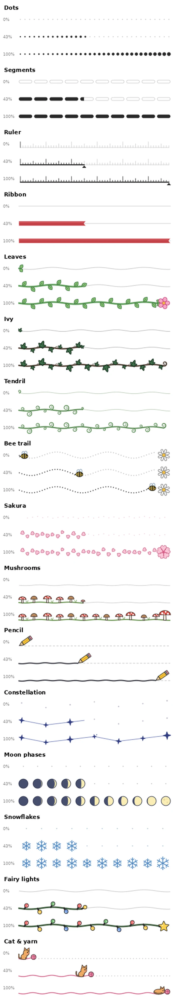
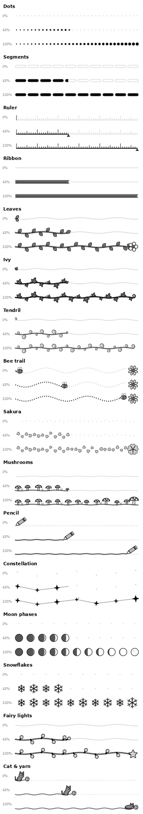

# Bookshelf bar styles

A KOReader userpatch that adds sixteen hand-drawn progress bar styles to the
[Bookshelf](https://github.com/AndyHazz/bookshelf.koplugin) plugin: from quiet
minimal bars to a vine that blooms, a bee heading for a daisy, or a kitten
chasing a ball of yarn.

> **Beta.** This is the first public release. If something looks off on your
> device, please open an issue with your e-reader model and a photo.

## The styles

| Group | Style | What it does |
| --- | --- | --- |
| Minimal | **Dots** | dots that grow in size as you read |
| | **Segments** | ten rounded segments filling up, the current one partly |
| | **Ruler** | a ruler whose ticks darken, with a small cursor |
| | **Ribbon** | a bookmark ribbon with a notched end |
| Nature | **Leaves** | a wavy stem with alternating leaves, ending in a pink flower |
| | **Ivy** | a darker twin of Leaves, with lobed ivy leaves and tendrils |
| | **Tendril** | a bare vine that grows nothing but curls |
| | **Bee trail** | a bee following a dotted path towards a daisy |
| | **Sakura** | drifting cherry petals and a blossom at the end |
| | **Mushrooms** | mushrooms sprouting along a mossy line, a big toadstool at the end |
| Stationery | **Pencil** | a pencil-drawn line with the pencil at its tip |
| Sky | **Constellation** | stars joined by thin lines, the last one grows when you finish |
| | **Moon phases** | a row of moons waxing from new to full |
| Seasonal | **Snowflakes** | snowflakes appearing one by one |
| | **Fairy lights** | a string of lights that grows, ending in a star |
| Animals | **Cat & yarn** | a kitten chasing a ball of yarn, napping next to it at the end |

Every style has a little "finished" moment when you reach 100%.

On colour screens (Kobo Libra Colour, Kindle Colorsoft, …) the styles use
their own colours. On greyscale screens they switch to shades of grey:

## Install

1. Download `2-bookshelf-bar-styles.lua` from the
   [latest release](../../releases).
2. Copy it to the `patches` folder inside your KOReader folder. On Kobo that
   is `/mnt/onboard/.adds/koreader/patches/` (create `patches` if it does not
   exist; `.adds` is a hidden folder).
3. Restart KOReader.

## Use

In Bookshelf, open the editor of a line that contains `%bar` and tap
**Bar: …** until the style you want shows up.

- **Raise the bar height** to around 200%. The drawings need about 20 px to
  read well; below 10 px the bar falls back to Bookshelf's *rounded* style.
- Colours picked in Bookshelf's bar colour menu still apply: the fill colour
  goes to the main element of each style (leaves, stars, line…) and the track
  colour to the part still to read.
- Vertical and reversed bars are drawn with the *rounded* style.

## Good to know

- The patch hooks into an internal Bookshelf module
  (`lib/bookshelf_bar_paint`). If a Bookshelf update renames it, the extra
  styles simply disappear until the patch is updated: no errors.
- If you remove the patch, bars set to one of these styles are drawn as
  *bordered*. Nothing else to fix.
- Shapes are drawn with soft, anti-aliased edges. On slower devices this may
  add a little time when the home screen redraws.

## Credits

Inspired by the "Scrapbook" look of the
[Reading Log](https://github.com/stevenzamora1/reading-log) plugin, and by
ideas from the r/koreader community. Bookshelf is by AndyHazz.

## License

[AGPL-3.0](LICENSE), the same licence as KOReader and Bookshelf.
